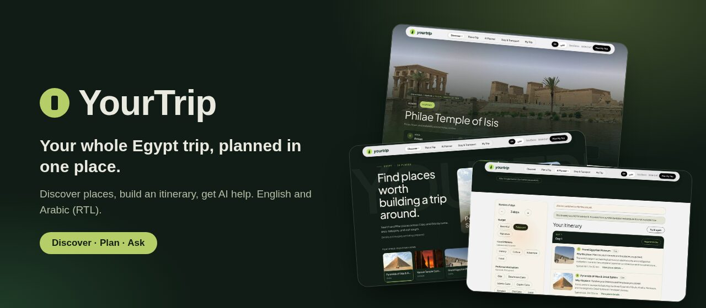
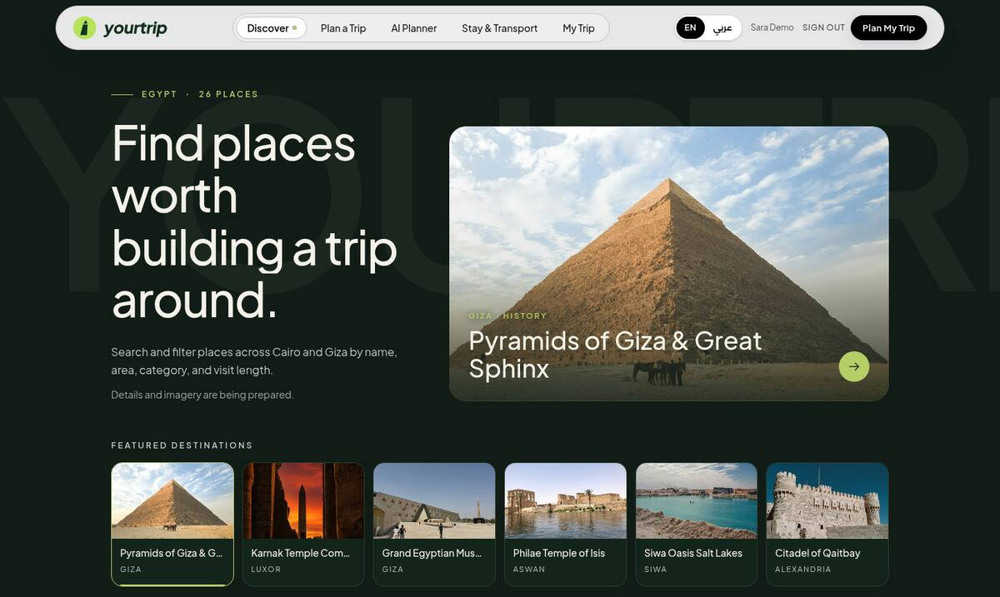
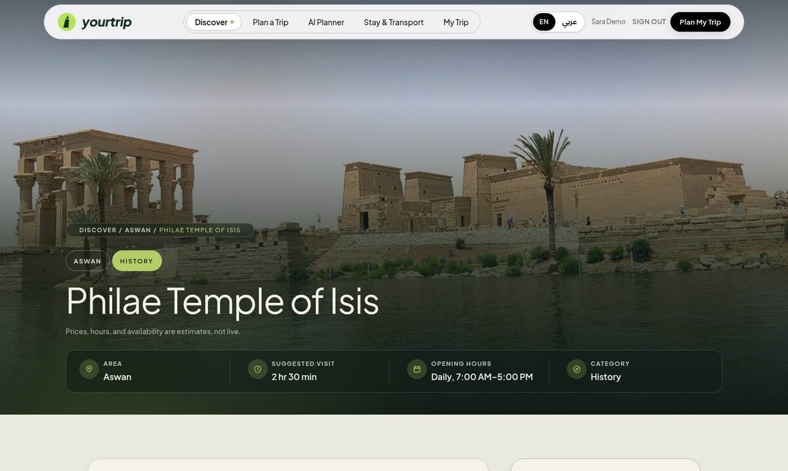
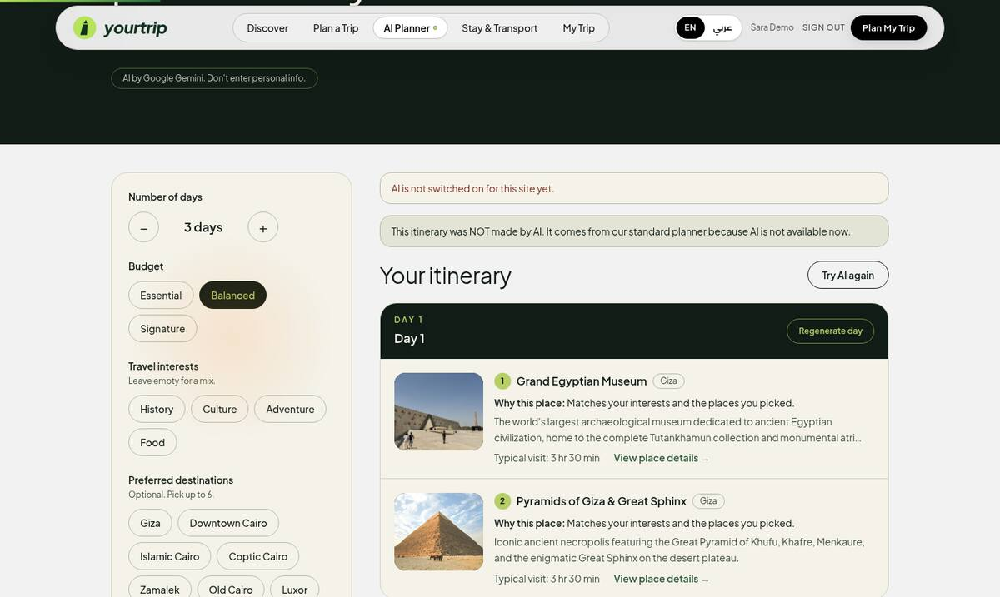
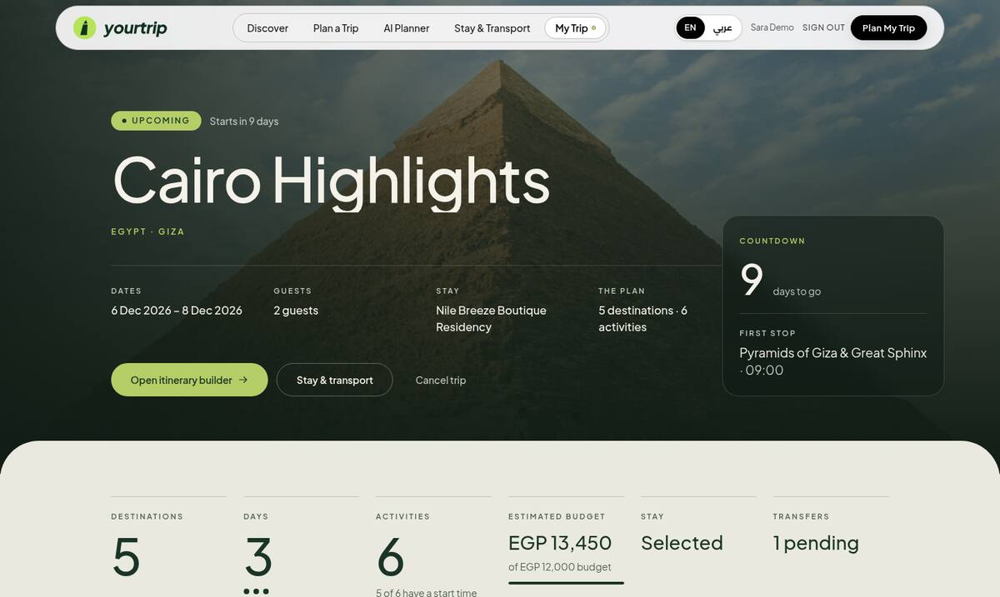
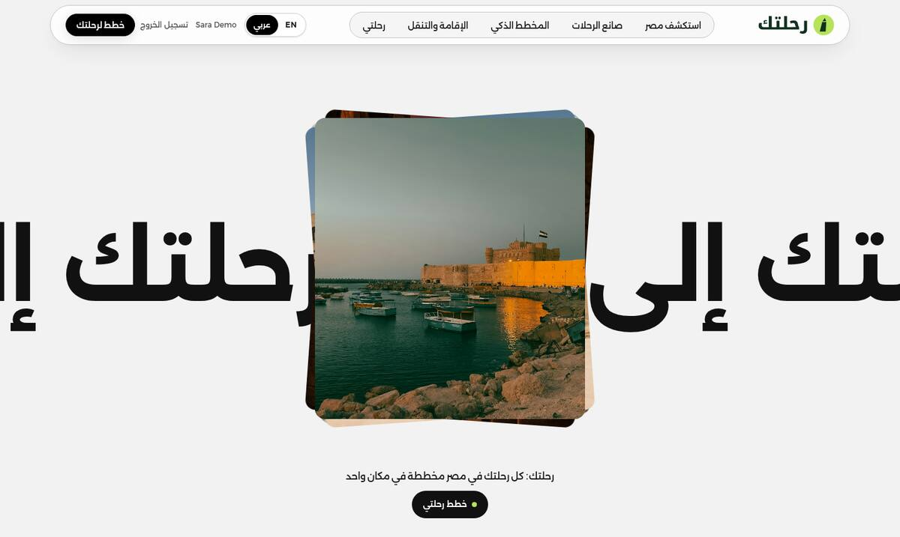
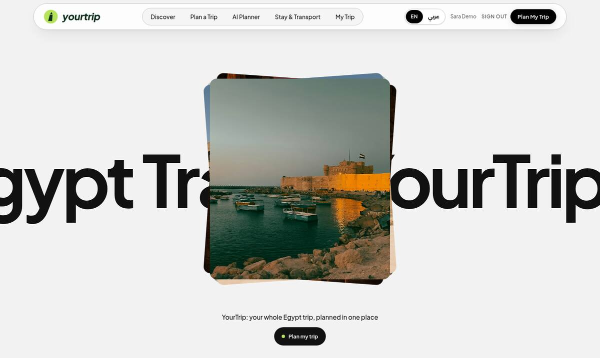

<a id="readme-top"></a>

<div align="center">

<a href="https://your-entire-egypt-trip-in-one-place-eight.vercel.app">
  
</a>

<br />
<br />

[![React][react-badge]][react-url]
[![TypeScript][ts-badge]][ts-url]
[![Vite][vite-badge]][vite-url]
[![Tailwind][tw-badge]][tw-url]
[![three.js][three-badge]][three-url]
[![Gemini][gemini-badge]][gemini-url]

**Discover places across Egypt, shape your itinerary, and get AI help along the way. English and Arabic (RTL).**

<a href="https://your-entire-egypt-trip-in-one-place-eight.vercel.app"><strong>Live demo</strong></a>
·
<a href="#features">Features</a>
·
<a href="#ai-features">AI features</a>
·
<a href="#quick-start">Quick start</a>
·
<a href="#tech-stack">Tech stack</a>
·
<a href="#limitations">Limitations</a>

</div>

<details>
  <summary>Table of contents</summary>
  <ol>
    <li><a href="#screenshots">Screenshots</a></li>
    <li><a href="#features">Features</a></li>
    <li><a href="#ai-features">AI features</a></li>
    <li><a href="#tech-stack">Tech stack</a></li>
    <li><a href="#quick-start">Quick start</a></li>
    <li><a href="#environment-variables">Environment variables</a></li>
    <li><a href="#project-structure">Project structure</a></li>
    <li><a href="#limitations">Limitations</a></li>
    <li><a href="#docs">Docs</a></li>
  </ol>
</details>

## Screenshots

<p align="center">
  
  
</p>
<p align="center">
  
  
</p>
<p align="center">
  
  
</p>

> [!NOTE]
> The AI planner screenshot was taken with no Gemini key set, so it shows the built-in fallback planner, labelled "NOT made by AI". That is what visitors see until a key is added.

<p align="right">(<a href="#readme-top">back to top</a>)</p>

## Features

| What it does                                                                                                                                                                                  | What it does                                                                                                                                                       |
| --------------------------------------------------------------------------------------------------------------------------------------------------------------------------------------------- | ------------------------------------------------------------------------------------------------------------------------------------------------------------------ |
| 🧭 **Discover** <br /> 26 places across 13 areas, from Giza and Downtown Cairo to Luxor, Aswan, Alexandria, Siwa and the Red Sea. Search and filter by name, area, category and visit length. | 🏛️ **Place details** <br /> Photo gallery, quick facts, opening hours, ticket price, tips, map location and nearby places, with "add to my trip".                  |
| 🗓️ **Trip planner** <br /> A six-step wizard that builds a day-by-day itinerary from the catalog, then an itinerary builder with drag and drop.                                               | 🤖 **AI Planner** <br /> Pick days, budget, interests, regions and style. Gemini plans using only places from Discover. Regenerate the whole plan or a single day. |
| 💬 **Ask About This Place** <br /> An assistant on every place page for history, best time to visit, what to expect, practical tips and location.                                             | 🏨 **Stay and transport** <br /> Accommodation and transport options with maps, and transfer requests.                                                             |
| 🧳 **My Trip** <br /> A dashboard with countdown, budget estimate, day-by-day route map and requests.                                                                                         | 🌍 **English and Arabic** <br /> Full RTL layout, Arabic typography and logical CSS properties.                                                                    |
| 🎞️ **Motion and 3D** <br /> GSAP, Framer Motion, smooth scrolling and React Three Fiber scenes.                                                                                               | 📱 **Responsive** <br /> Responsive layouts for phones and desktops (key pages checked at 390 px and 1440 px).                                                     |

<p align="right">(<a href="#readme-top">back to top</a>)</p>

## AI features

The AI Planner (`/ai-planner`) and Ask About This Place call Vercel serverless functions in `client/api/ai/`, with shared code in `client/ai-api/`. The Gemini key is read on the server only and is never in frontend code.

- **Grounded.** The model sees catalog fields only: id, name, area, category, tags, a short description, rounded coordinates, visit minutes and ticket price. No account or itinerary personal details are sent. Emails and phone numbers are removed from questions.
- **Checked.** The server validates every request (method, JSON, size, allowed values) and checks the origin. It drops unknown or duplicate places and far-apart stops, and removes text that states prices, hours or durations that are not in the data.
- **Safe fallback.** Without `GEMINI_API_KEY`, or when Gemini fails, the planner uses the standard catalog planner and Ask answers from the place's own data. Nothing breaks.
- **Clear to users.** The UI says "AI by Google Gemini. Don't enter personal info."

> [!WARNING]
> The rate limiter is per serverless instance. It is a best-effort brake, not a hard daily cap. See [Limitations](#limitations).

<p align="right">(<a href="#readme-top">back to top</a>)</p>

## Tech stack

| Area               | Tools                                                                  |
| ------------------ | ---------------------------------------------------------------------- |
| App                | React 19, TypeScript 6, Vite 8, React Router 7                         |
| Styling            | Tailwind CSS 4, scoped CSS themes                                      |
| Motion and 3D      | GSAP, Framer Motion, Lenis, three.js with React Three Fiber and drei   |
| Maps               | Leaflet with react-leaflet                                             |
| Interaction        | dnd-kit (drag and drop itinerary)                                      |
| i18n               | i18next, react-i18next (EN and AR)                                     |
| AI                 | Google Gemini REST API behind Vercel functions                         |
| Backend (optional) | Express 5, MongoDB with Mongoose, Zod, Argon2, JWT in httpOnly cookies |
| Quality            | Vitest, ESLint, Prettier, `tsc -b`                                     |

<p align="right">(<a href="#readme-top">back to top</a>)</p>

## Quick start

Requirements: Node.js `>=22.12.0` and npm.

```bash
git clone https://github.com/yousefmetawea/Your-Entire-Egypt-Trip-in-One-Place.
cd Your-Entire-Egypt-Trip-in-One-Place.
npm install

# run the website on built-in demo data (no backend needed)
echo "VITE_DATA_SOURCE=mock" > client/.env.local
npm run dev:client
```

Open <http://localhost:5173>. Demo accounts and trips are stored in your browser's `localStorage`.

<details>
<summary><b>Turn on the AI features locally</b></summary>

<br />

Add your key to `client/.env.local`. This file is git-ignored. Never commit a key and never prefix it with `VITE_`.

```bash
GEMINI_API_KEY=your_key_here
```

Restart `npm run dev:client`. A dev-only Vite plugin serves `/api/ai/*` with the same code Vercel runs.

</details>

<details>
<summary><b>Run with the real backend (optional)</b></summary>

<br />

```bash
cp client/.env.example client/.env
cp server/.env.example server/.env   # set MONGODB_URI and JWT_SECRET
npm run dev                          # client on :5173, API on :4000
```

</details>

<details>
<summary><b>Deploy on Vercel</b></summary>

<br />

The Vercel project root is `client/`. Set `VITE_DATA_SOURCE=mock` (and no `VITE_API_BASE_URL`) to deploy the demo without a backend. Add `GEMINI_API_KEY` for Production and Preview to enable AI, then redeploy, because variables only apply to new deployments.

</details>

<details>
<summary><b>Scripts</b></summary>

<br />

Run from the repo root.

```bash
npm run dev:client                 # website
npm run dev:server                 # backend
npm run lint                       # ESLint
npm run typecheck                  # tsc -b
npm run test --workspace client    # client tests
npm run build --workspace client   # production build
npm run format:check               # Prettier
```

</details>

<p align="right">(<a href="#readme-top">back to top</a>)</p>

## Environment variables

Names only. Never put real values in the repo.

| Variable                                                                                                                                            | Where                         | Purpose                                             |
| --------------------------------------------------------------------------------------------------------------------------------------------------- | ----------------------------- | --------------------------------------------------- |
| `VITE_DATA_SOURCE`                                                                                                                                  | client                        | `mock` for demo data, `api` for the Express backend |
| `VITE_API_BASE_URL`                                                                                                                                 | client                        | Backend URL, used when the data source is `api`     |
| `GEMINI_API_KEY`                                                                                                                                    | Vercel or `client/.env.local` | Enables the AI features. Server-side only           |
| `GEMINI_MODEL`                                                                                                                                      | same (optional)               | Gemini model name                                   |
| `AI_DAILY_LIMIT`                                                                                                                                    | same (optional)               | Daily request cap per function instance             |
| `AI_ALLOWED_ORIGINS`                                                                                                                                | same (optional)               | Extra allowed origins, comma separated              |
| `PORT`, `NODE_ENV`, `MONGODB_URI`, `JWT_SECRET`, `JWT_EXPIRES_IN`, `CLIENT_ORIGIN`, `RATE_LIMIT_WINDOW_MS`, `RATE_LIMIT_MAX`, `AUTH_RATE_LIMIT_MAX` | server                        | Backend settings, see `server/.env.example`         |

<p align="right">(<a href="#readme-top">back to top</a>)</p>

## Project structure

```text
client/
  api/ai/            Vercel functions: plan.ts, ask.ts
  ai-api/            AI server code: validation, rate limit, Gemini client, tests
  src/
    app/             router and site layout
    pages/           Home, Discover, PlaceDetails, TripCreator, AiPlanner, MyTrip, ...
    components/      ui, places, planner, trip-builder, stay-transport, three, ai, ...
    services/        mock and api data services, ai client
    lib/             catalog, planner and helpers
    i18n/locales/    en.json, ar.json
  public/            images and icons
server/              optional Express + MongoDB API
docs/                plan, API, server guide, planner rules, image credits, screenshots
```

<p align="right">(<a href="#readme-top">back to top</a>)</p>

## Limitations

- **Demo data.** The catalog is seed data in `client/src/services/mock/seed/`. Prices, hours and availability are estimates, not live. There are no real bookings.
- **Mock sign-in.** It is for demos only and stores data in the browser, not on a server.
- **AI rate limit.** It is per serverless instance, not a hard cap across Vercel. For a hard cap, add a Vercel Firewall rule and set a quota in Google AI Studio.
- **AI data.** The AI endpoints read the mock seed catalog, so they match the website only in `mock` mode, not when the site uses the Express backend.
- **Gemini terms.** The free tier may use submitted content to improve Google products, and its terms restrict under-18 audiences. Enable AI only for audiences where that fits.
- **AI can be wrong.** The site tells users to check hours and prices on the place page.
- **Images.** Attribution is recorded in [`docs/image-credits.md`](docs/image-credits.md) for the Wikimedia photos listed there. The source of other bundled photos is not documented yet.
- **License.** No license file has been added yet.

<p align="right">(<a href="#readme-top">back to top</a>)</p>

## Docs

[`docs/PLAN.md`](docs/PLAN.md) · [`docs/api.md`](docs/api.md) · [`docs/server.md`](docs/server.md) · [`docs/planner-rules.md`](docs/planner-rules.md) · [`docs/decisions.md`](docs/decisions.md)

<p align="right">(<a href="#readme-top">back to top</a>)</p>

<!-- badges -->

[react-badge]: https://img.shields.io/badge/React-20232A?style=for-the-badge&logo=react&logoColor=61DAFB
[react-url]: https://react.dev/
[ts-badge]: https://img.shields.io/badge/TypeScript-3178C6?style=for-the-badge&logo=typescript&logoColor=white
[ts-url]: https://www.typescriptlang.org/
[vite-badge]: https://img.shields.io/badge/Vite-646CFF?style=for-the-badge&logo=vite&logoColor=white
[vite-url]: https://vite.dev/
[tw-badge]: https://img.shields.io/badge/Tailwind_CSS-06B6D4?style=for-the-badge&logo=tailwindcss&logoColor=white
[tw-url]: https://tailwindcss.com/
[three-badge]: https://img.shields.io/badge/three.js-000000?style=for-the-badge&logo=threedotjs&logoColor=white
[three-url]: https://threejs.org/
[gemini-badge]: https://img.shields.io/badge/Gemini-8E75B2?style=for-the-badge&logo=googlegemini&logoColor=white
[gemini-url]: https://ai.google.dev/
